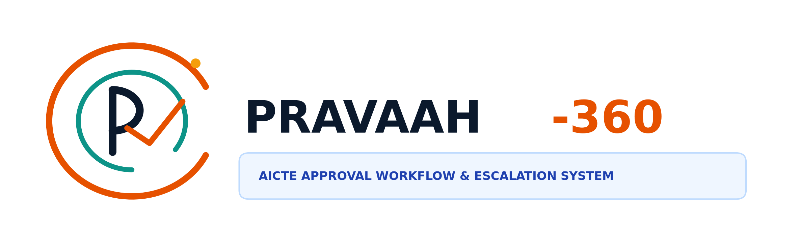
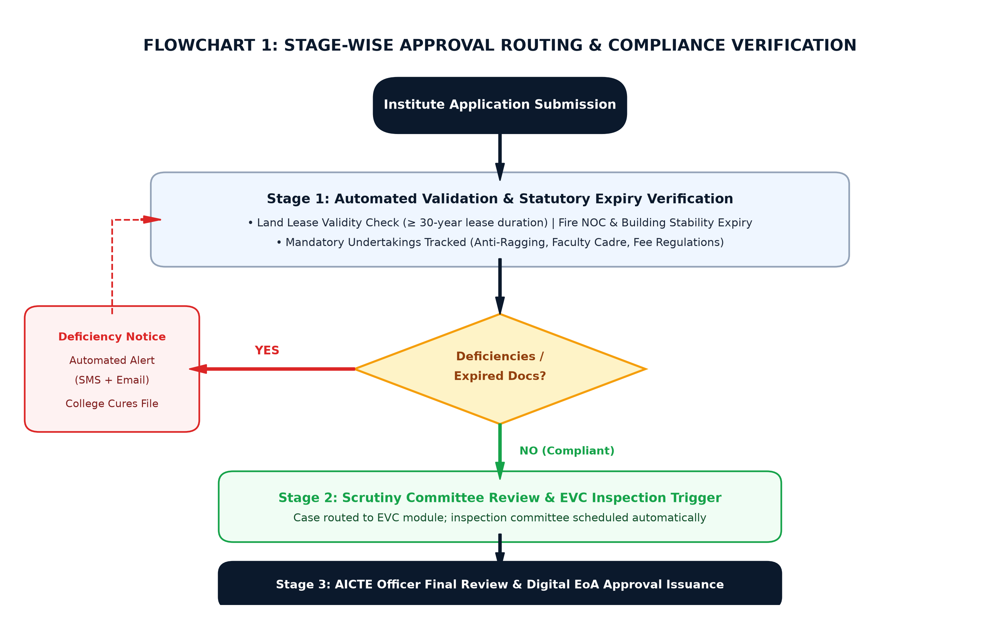
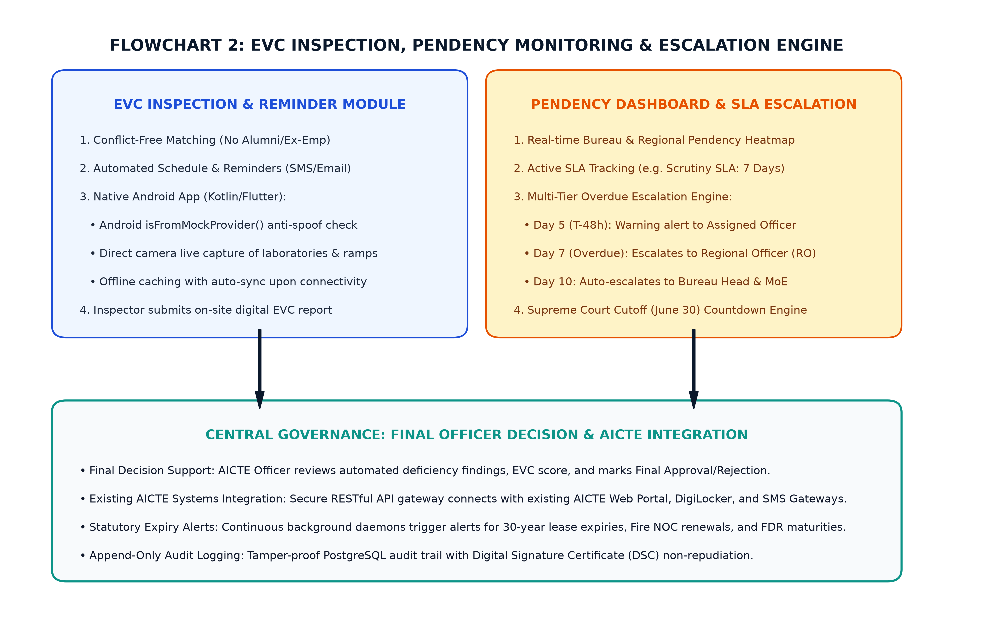

# PRAVAAH-360: Integrated AICTE Approval Workflow Automation & SLA Escalation System

<div align="center">



**Smart India Hackathon (SIH 2026) • Ministry of Education (MoE) • AICTE**

[](https://frontend-lyart-chi-21.vercel.app)
[](https://sih.gov.in)
[](#)
[](#)

### 🌐 **[Live Prototype Demo (Click Here)](https://frontend-lyart-chi-21.vercel.app)**

</div>

---

## 📌 Executive Summary

**PRAVAAH-360** (*Proactive Regulatory Automation, Verification & Alert Architecture with High-Assurance*) is an enterprise-grade regulatory governance platform engineered for the **All India Council for Technical Education (AICTE)**. 

Every year, 10,500+ technical institutions apply for **Extension of Approval (EoA)**, intake variation, or program introductions. PRAVAAH-360 eliminates manual scrutiny gridlocks, tracks 30-year land lease expiries, provides bureau pendency heatmaps, enforces anti-mock GPS inspection for visiting committees, and guarantees 100% adherence to **Supreme Court (*Parshvanath Charitable Trust Case*)** June 30 national approval cutoffs.

---

## 🚀 Key Functional Capabilities

### 1. Statutory Document & Lease Expiry Tracking Engine
* **Proactive Expiry Daemons:** Automated **90, 60, and 30-day proactive alert cascades** dispatched via SMS and Email to the Institution Chairman and Registrar.
* **Monitored Records:**
  * 30-Year Campus Land Lease Validity
  * Municipal Fire Safety & Hydrant NOC
  * Structural Building Stability Certificate
  * Joint FDR Security Deposit Lien with AICTE

### 2. Mandatory Undertakings & Affidavits Ledger
* Tracks mandatory regulatory submissions (Anti-Ragging undertakings, Faculty Cadre Ratio affidavits, and Fee Regulatory compliance).
* Provides automated compliance validation against the **Approval Process Handbook (APH 2024–2027)**.

### 3. Stage-Wise Sequential Approval Routing
A structured 5-stage state-machine pipeline:
```
[1. Application Ingestion] ➔ [2. Document Scrutiny] ➔ [3. EVC Field Inspection] ➔ [4. Regional Committee Review] ➔ [5. Final Officer EoA Sign-Off]
```

### 4. Bureau-Wise Pendency Dashboard & Hierarchy Escalation Engine
* **Regional Heatmap:** Real-time visibility into application queues and SLA latencies across all 8 AICTE Regional Offices.
* **Hierarchy Auto-Escalation:** Overdue files that exceed SLA thresholds (e.g., 7 days) automatically escalate:
  $$\text{Assigned Officer (T-48h warning)} \longrightarrow \text{Regional Officer} \longrightarrow \text{Bureau Head} \longrightarrow \text{Member Secretary}$$

### 5. Native Android EVC Mobile Inspection Companion
* **Hardware Attestation:** Uses Android's `Location.isFromMockProvider()` API to detect and block fake GPS location spoofing.
* **Live Camera Sandbox:** Enforces live camera capture for laboratories and barrier-free ramps with embedded GPS EXIF stamps (gallery uploads disabled).
* **Offline-First Mode:** Supports local Room SQLite caching for remote rural campuses with zero 4G connectivity, auto-syncing upon reconnecting.

### 6. Human-in-the-Loop Officer Decision Support
* The automated system calculates deficiencies and provides decision metrics, but **final approval/rejection authority rests strictly with the authorized AICTE Officer** via Digital Signature Certificates (DSC).

### 7. Public Extension of Approval (EoA) QR Verification
* Allows students, parents, and citizens to verify genuine AICTE course approvals and sanctioned intake matrices via cryptographic QR lookup, preventing fake college admission rackets.

---

## 📊 System Architecture & Procedural Flowcharts

### Flowchart 1: Stage-Wise Approval Routing & Expiry Alerts


### Flowchart 2: Native EVC App & Bureau Pendency Escalation


---

## 🛠️ Technology Stack

| Layer | Technologies Used |
|---|---|
| **Frontend Web App** | React 19, TypeScript, Vite, Tailwind CSS v4, Lucide Icons |
| **Field Mobility** | Native Android (Kotlin / Flutter), Room SQLite |
| **Backend & Rules** | Python (FastAPI), Celery Task Queues, Redis |
| **Persistence & Audit** | PostgreSQL 16 (Append-Only Audit Tables), MinIO S3 Vault |
| **Security & Standards** | Digital Signature Certificates (DSC), SHA-256 EXIF seals, DPDP Act 2023 |
| **Deployment** | Vercel (Frontend), Docker, MeghRaj (NIC Cloud Ready) |

---

## 📂 Repository Structure

```
├── frontend/                     # React + TypeScript + Vite web application
│   ├── src/
│   │   ├── components/
│   │   │   ├── Navbar.tsx        # Council header, countdown banner & role switcher
│   │   │   ├── InstitutionPortal.tsx # Lease expiry tracker & deficiency scorecard
│   │   │   ├── BureauConsole.tsx # Pendency heatmap & escalation simulator
│   │   │   ├── EVCMobileSimulator.tsx # Native Android mobile inspection frame
│   │   │   ├── PublicVerification.tsx # Official EoA Letter & QR verification
│   │   │   └── AuditLogDrawer.tsx # Append-only DSC statutory audit ledger
│   │   ├── data/
│   │   │   └── mockData.ts       # AICTE sample applications & regional metrics
│   │   └── App.tsx
│   └── package.json
├── SIH26262_AICTE_Winning_Presentation.pptx # Official 6-slide SIH submission deck
├── SIH26262_PRAVAAH360_Project_Synopsis.pdf # Complete executive project synopsis
├── flowchart_rules_engine.png    # High-resolution procedural flowchart 1
├── flowchart_blind_inspection.png# High-resolution procedural flowchart 2
├── pravaah360_logo.png           # High-resolution project logo
└── README.md
```

---

## 👥 Smart India Hackathon (SIH 2026) Submission

* **Problem Statement ID:** `SIH26262`
* **Problem Statement Title:** *Integrated AICTE Approval Workflow Automation, Compliance Monitoring and Alert Management System*
* **Organization:** All India Council for Technical Education (AICTE), Ministry of Education
* **Live Deployment:** [https://frontend-lyart-chi-21.vercel.app](https://frontend-lyart-chi-21.vercel.app)
